# Azure Synapse E-Commerce Data Warehouse & Analytics

**End-to-end cloud data engineering, lake-based data warehousing and Power BI analytics**

An independent portfolio project that integrates shopping-cart and product catalogue data from the [Fake Store REST API](https://fakestoreapi.com/), processes nested JSON using **Azure Synapse Apache Spark / PySpark**, models analytical **fact and dimension datasets**, and exposes curated **Parquet** files through **Synapse Serverless SQL** for interactive **Power BI** reporting.

> **Data disclaimer:** The source is a demonstration API, and most carts were generated synthetically for testing. **Basket value is an estimate**, calculated from cart quantities and catalogue prices; it is **not verified sales revenue** or evidence of actual customer behaviour.

## Project at a glance

| Area | Implementation |
|---|---|
| Ingestion | Synapse Pipelines; REST API `/carts` and `/products` |
| Storage | Azure Data Lake Storage Gen2; `raw/` JSON and `curated/` Parquet |
| Processing | Apache Spark / PySpark; nested JSON flattening, joins and validation |
| Analytical model | `FactCartLines`, `DimProduct`, `DimDate` |
| Query serving | Synapse Serverless SQL; `SalesDW` database and views over Parquet |
| Reporting | Power BI; basket KPIs, time trends, category and product comparisons |
| Test-data expansion | 5,000 additional synthetic carts generated reproducibly |
| Notebook output observed | **12,557 cart lines / 5,007 distinct carts** |

## Architecture

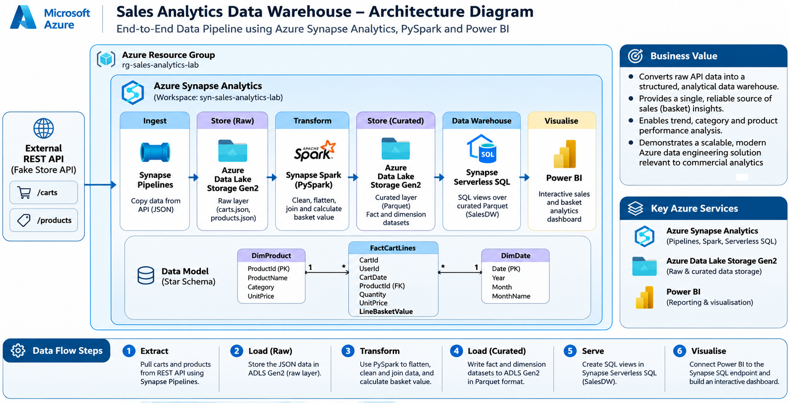

**Data flow:** Fake Store API (`/carts`, `/products`) → Synapse Pipelines → ADLS Gen2 raw JSON → Synapse Spark / PySpark → ADLS Gen2 curated Parquet (`FactCartLines`, `DimProduct`, `DimDate`) → Synapse Serverless SQL views → Power BI.

The project uses a **logical lake-based warehouse**: Synapse Serverless SQL queries the Parquet files in the data lake rather than storing copies in a dedicated SQL pool.

## Engineering implementation

### 1. REST API ingestion

Synapse pipeline `PL_Sales_Warehouse` uses two Copy Data activities:

- `Copy_Carts` reads `https://fakestoreapi.com/carts` into `raw/carts.json`.
- `Copy_Products` reads `https://fakestoreapi.com/products` into `raw/products.json`.

The raw layer preserves the API responses before transformations.

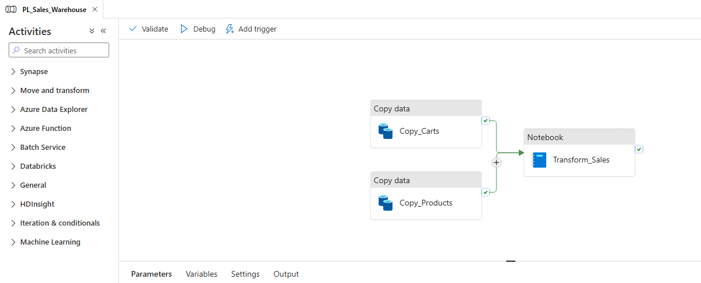

### 2. PySpark transformations

Notebook `NB_Transform_Sales`:

1. Reads the two JSON datasets into Spark DataFrames.
2. Uses `explode()` to turn each cart's nested `products` array into individual cart lines.
3. Standardises types, removes invalid quantities/prices and deduplicates product keys.
4. Joins cart lines to product attributes using `ProductId`.
5. Calculates `LineBasketValue = Quantity × UnitPrice` using decimal types.
6. Generates additional reproducible synthetic cart records with valid product references, then combines them with the API records using `unionByName()`.
7. Produces fact and dimension DataFrames and writes them in Parquet format.

**Grain:** each row in `FactCartLines` represents **one product line in one cart**. Repeated `CartId` values are therefore expected. Cart volume must be calculated with `DISTINCTCOUNT(CartId)` or SQL `COUNT(DISTINCT CartId)`.

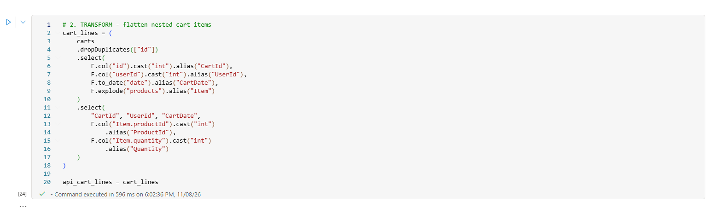

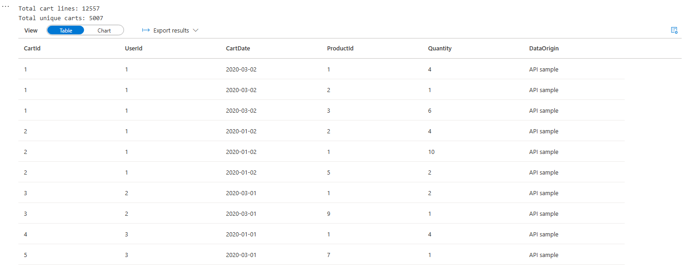

### 3. Data model and storage

| Dataset | Fields (selection) | Purpose |
|---|---|---|
| `FactCartLines` | `CartId`, `UserId`, `CartDate`, `ProductId`, `Quantity`, `UnitPrice`, `LineBasketValue` | Measures at cart-line grain |
| `DimProduct` | `ProductId`, `ProductName`, `Category`, `UnitPrice` | Product and category reporting |
| `DimDate` | `Date`, `Year`, `Month`, `MonthName` | Date filtering and trends |

Curated files are stored under:

```text
sales/
├── raw/
│   ├── carts.json
│   └── products.json
└── curated/
    ├── fact_cart_lines/
    ├── dim_product/
    └── dim_date/
```

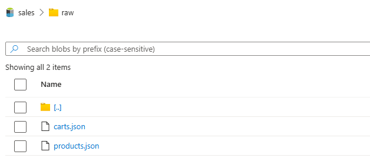

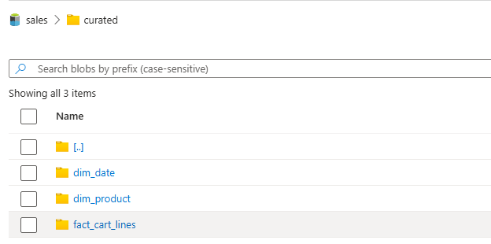

### 4. Synapse Serverless SQL

In the `SalesDW` database, analytical SQL views query curated Parquet files:

- `dbo.vwFactCartLines`
- `dbo.vwDimProduct`
- `dbo.vwDimDate`

The views use `OPENROWSET(... FORMAT = 'PARQUET')`, enabling SQL and BI tools to query the same curated data without loading it into a dedicated warehouse. Add the actual, sanitised view definitions to `sql/create_serverless_views.sql` and the validation queries to `sql/validation_queries.sql`.

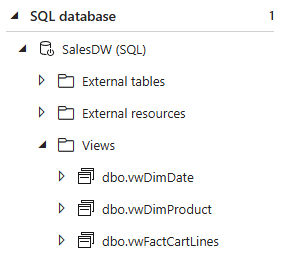

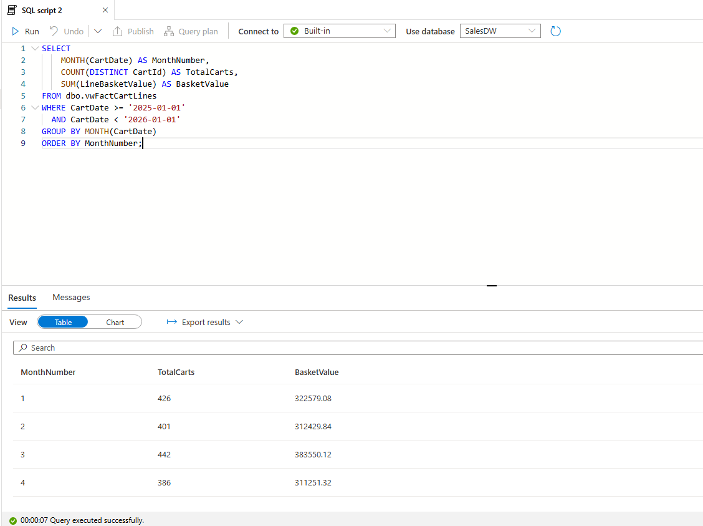

### 5. Power BI dashboard

The Power BI report, **E-Commerce Basket Analytics**, uses views from Synapse Serverless SQL. It contains four headline measures:

| KPI | Calculation |
|---|---|
| Total Basket Value | `SUM(LineBasketValue)` |
| Total Carts | `DISTINCTCOUNT(CartId)` |
| Total Items | `SUM(Quantity)` |
| Average Basket Value | `Total Basket Value / Total Carts` |

The dashboard also provides basket value over time, basket value by product category, Top 10 products by basket value, and interactive date/category filters.

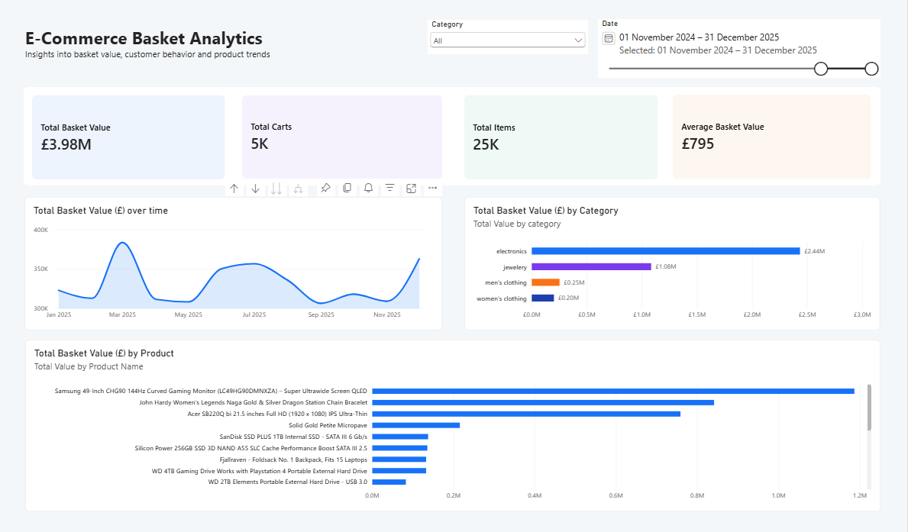

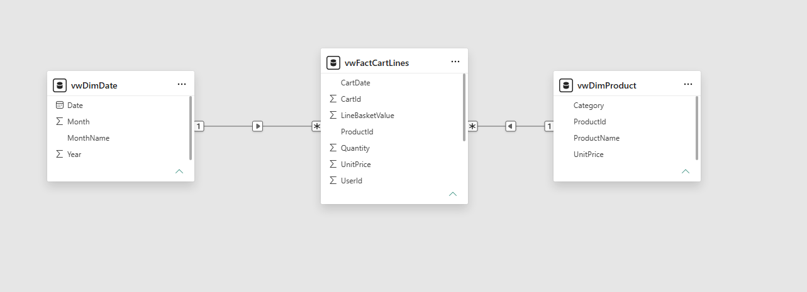

> **Reporting interpretation:** A cart is not necessarily a completed order. The visualisations demonstrate reporting functionality rather than actual financial results.

## Testing and validation

The extended notebook run produced **12,557 cart lines** from **5,007 distinct carts**, including **5,000 generated carts**. Validation focused on checking valid product references, quantities and prices; understanding cart-line grain; confirming curated files; and querying the SQL views.

See [`sql/validation_queries.sql`](sql/validation_queries.sql) for sample SQL tests against the actual view names. Replace or augment these with the precise queries you used during development.

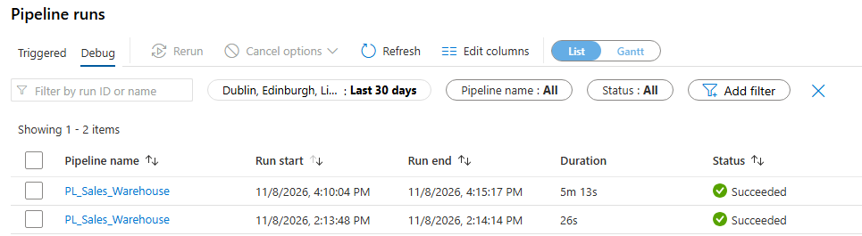

## Engineering challenges

- **Nested cart structures:** used PySpark `explode()` to flatten product arrays before joins and aggregations.
- **Limited API volume:** generated synthetic carts with a fixed random seed and distinct IDs to support broader dashboard testing.
- **Data grain:** recognised that repeated cart IDs are expected and used distinct counting for cart metrics.
- **Azure storage provisioning:** adjusted an unavailable redundancy configuration and used LRS storage.
- **Destination schema import:** handled cases where Synapse attempted to inspect an output JSON file before its first write.
- **Spark session diagnostics:** investigated a Livy timeout through Spark execution/session logs; its original root cause was not conclusively established.

## Limitations and possible improvements

This is a learning/portfolio project, **not a production e-commerce warehouse**. Improvements would include incremental ingestion, automated quality tests, failure alerts and retries, historical item prices, more comprehensive dimensional modelling, and coordinated Power BI refreshes. The source's synthetic additions should always be labelled and should not be mistaken for genuine demand patterns.

Pipeline scheduling, end-to-end automated refresh and deployment are **not claimed** here unless verified separately.

## Repository contents

```text
azure-synapse-ecommerce-data-warehouse/
├── README.md
├── .gitignore
├── synapse/
│   └── NB_Transform_Sales.ipynb         # export your real notebook
├── sql/
│   ├── create_serverless_views.sql      # add your real view definitions
│   └── validation_queries.sql          # example validation queries provided
├── sample-data/
│   ├── carts_sample.json               # optional small API sample
│   └── products_sample.json            # optional small API sample
└── docs/
    ├── SCREENSHOTS.md
    └── images/
        ├── architecture.png
        ├── synapse-pipeline.png
        ├── synapse-successful-run.png
        ├── adls-raw.png
        ├── adls-curated.png
        ├── pyspark-transformations.png
        ├── notebook-record-counts.png
        ├── serverless-sql-views.png
        ├── sql-validation.png
        ├── powerbi-model.png
        └── powerbi-dashboard.png
```

**Repository choice:** Azure ARM templates, Synapse pipeline export files and the Power BI `.pbix` are intentionally not published. The relevant interfaces and outcomes are documented with screenshots. The PySpark notebook and SQL queries are included to demonstrate the underlying engineering work.

## Security and reproducibility

- No passwords, connection strings, SAS tokens, keys or sensitive workspace configuration should be committed.
- Review exported notebooks and screenshots, including outputs, before uploading.
- The Synapse notebook depends on access to an Azure Spark environment and ADLS Gen2 paths; it is not intended to execute locally without environment configuration.
- Source data is public demo content plus explicitly identified synthetic records.

## Source

- [Fake Store REST API](https://fakestoreapi.com/)
- [Azure Synapse Analytics documentation](https://learn.microsoft.com/en-us/azure/synapse-analytics/)
- [Synapse Serverless SQL and OPENROWSET](https://learn.microsoft.com/en-us/azure/synapse-analytics/sql/develop-openrowset)
